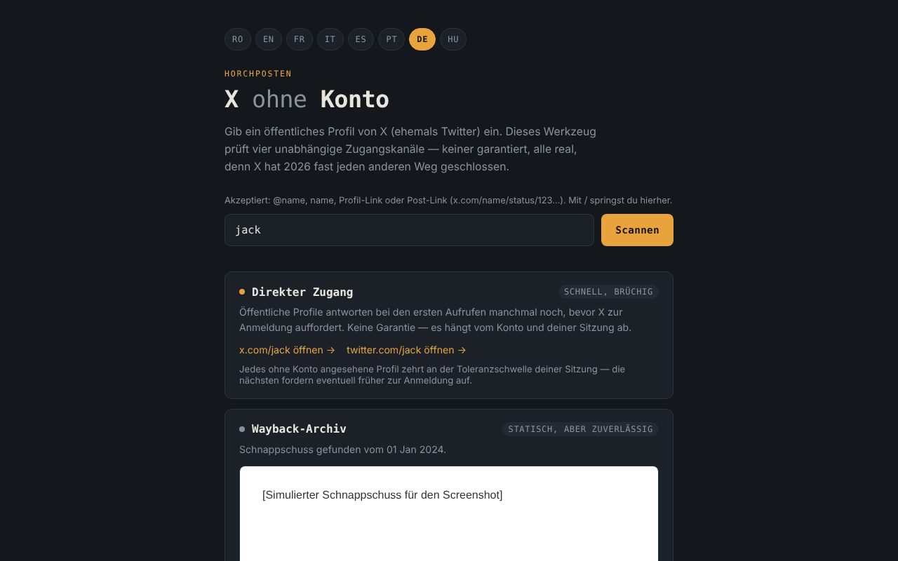

# X fără cont

[English](README.md) · [Română](README.ro.md) · [Français](README.fr.md) · [Italiano](README.it.md) · [Español](README.es.md) · [Português](README.pt.md) · **Deutsch** · [Magyar](README.hu.md)

**Version:** 1.2.2 · **Zuletzt aktualisiert:** 2026-10-22

Oberflächensprachen: **Română, English, Français, Italiano, Español, Português (PT), Deutsch, Magyar**

Werkzeugsatz zum Ansehen öffentlicher Profile auf X (ehemals Twitter) ohne Konto, in 8 Sprachen, in einer einzigen HTML-Datei.

**Online-App:** https://chiuta.github.io/X-fara-cont/

## Was es ist

Du gibst einen Profilnamen oder einen Link ein; die Anwendung erzeugt vier Zugangs-„Kanäle“, alle ohne Konto und ohne Garantien: direkter Link, Archiv der Wayback Machine, Suchindex (Google/Bing) und Verweis auf Nitter-Instanzen. Es ist kein Scraper: Es liest keine Inhalte von X (der Browser verhindert das durch CORS), sondern baut nur Links und prüft die Verfügbarkeit eines Snapshots bei archive.org.

## Funktionen

- Oberfläche in 8 Sprachen: RO, EN, FR, IT, ES, PT, DE, HU (die Browsersprache wird automatisch erkannt, sonst RO; sie kann über die Schaltflächen geändert werden).
- Akzeptiert `@name`, `name`, einen Profil-Link oder einen Beitrags-Link von x.com / twitter.com (`…/name/status/123…`); der Name wird validiert (1–15 Buchstaben, Ziffern oder `_`), und die Namen von Bereichen der Website (`home`, `explore`, `i`, `search` usw.) werden abgelehnt. Bei einem Beitrag zielen die direkten Links, die Wayback-Abfrage, die Google-/Bing-Suche und der Link „Neuen Snapshot anfordern“ auf die genaue Adresse des Beitrags.
- Bei Beitrags-Links zeigt sie das Erstellungsdatum des Beitrags (UTC), lokal aus der ID berechnet (Snowflake-IDs enthalten einen Zeitstempel; die Berechnung gilt nur für IDs nach November 2010). Das hilft bei der Wahl des passenden Wayback-Snapshots; es wird keine Netzwerkanfrage gestellt.
- Der Link „Alle archivierten Aufnahmen“ zur vollständigen Liste der Aufnahmen in der Wayback Machine (in allen Zuständen des Archivkanals).
- Eine Hilfszeile über dem Feld mit den akzeptierten Formaten; die Taste `/` setzt den Fokus in das Feld.
- Kanal 1 — direkte Links zu x.com und twitter.com.
- Kanal 2 — fragt die API `archive.org/wayback/available` ab (x.com, dann twitter.com) und zeigt, falls ein Snapshot gefunden wird, diesen in einem isolierten Frame (Sandbox) an und bietet einen Link zur Wayback Machine; andernfalls bietet sie „Neuen Snapshot anfordern“. Die Abfrage hat ein Zeitlimit von 8 Sekunden, und ein neuer Scan bricht den vorherigen ab.
- Kanal 3 — Google- und Bing-Suchen nach `site:x.com OR site:twitter.com "name"` (öffnen sich nur beim Klick).
- Kanal 4 — Link zur Liste der Nitter-Instanzen (GitHub) und das Adressmuster.

## Anleitung

1. Wähle die Sprache mit den Schaltflächen oben (optional).
2. Gib den Profilnamen ein oder füge den Link ein und drücke „Scannen“.
3. Nutze die Links jedes Kanals; warte bei „Wayback-Archiv“ auf das Ergebnis der Prüfung.
4. Gibt es kein Archiv, kannst du über den angebotenen Link ein neues anfordern (es öffnet sich auf web.archive.org).

## Datenschutz und Netzwerk

- Lokaler Speicher: Es werden weder `localStorage`, `sessionStorage`, IndexedDB noch Cookies verwendet.
- Keine Telemetrie, keine Konten, keine externen Skripte oder Schriftarten. Die CSP der Seite erlaubt Verbindungen nur zu archive.org.
- Beim „Scannen“ wird **der Profilname an archive.org gesendet**: bis zu 2 Abfragen (eine für x.com, eine für twitter.com, die zweite nur, wenn die erste nichts findet). Existiert ein Snapshot, lädt der Frame eine Seite von web.archive.org (ein weiterer Kontakt mit archive.org; deine IP-Adresse ist für sie sichtbar). Es wird kein Referrer gesendet.
- Die Links zu x.com, twitter.com, google.com, bing.com, github.com (Nitter) und web.archive.org (Speichern) öffnen sich nur, wenn du sie anklickst.
- Es werden keine Browserberechtigungen angefordert.

## Grenzen und Warnhinweise

- Kein Weg ist garantiert: X kann jederzeit eine Anmeldung verlangen, Archive können fehlen oder veraltet sein, Nitter-Instanzen sind instabil.
- Die Aussagen in der Oberfläche über den Zustand von X/Nitter im Jahr 2026 (zum Beispiel „X hat fast jeden anderen Weg geschlossen“) sind Beobachtungen des Autors. Der Zustand von Nitter/XCancel wurde am 11.10.2026 geprüft (siehe Verlauf); er kann sich jederzeit ändern.
- Das Archiv kann Inhalte Dritter enthalten; der Frame ist isoliert, behandle ihn aber wie jede externe Seite.
- Die Anwendung ist weder mit X Corp., Internet Archive, Google, Microsoft noch dem Nitter-Projekt verbunden.

## Lokale Ausführung / offline

Lade `index.html` herunter und öffne sie in einem Browser. Die Link-Erzeugung funktioniert ohne Internet; die Archivprüfung und die externen Links benötigen eine Verbindung.

## Verlauf / Changelog

### 1.2.2 — 2026-10-22
- Mobil: kein Text unter 12 px und Touch-Ziele von mindestens 24 px (WCAG 2.5.8).

### 1.2.1 — 2026-10-22
- Titel, Meta-Beschreibung und die Beschreibung im fff-kit-Transparenzpanel folgen jetzt der Oberflächensprache.

### 1.1.0 — 2026-10-14
- Sicherungskopie und Datenkennzeichnung (fff-kit).

### 12. Oktober 2026 (v1.0.0)
- 1.0.0 — 2026-10-12: Version und Datum der letzten Aktualisierung werden in der Anwendung angezeigt

### 11. Oktober 2026 (dritter Eintrag)
- Horizontalen Überlauf bei 360 px behoben (reproduziert mit einem langen Beitrags-Link: scrollWidth 483 → 360); Links und das Nitter-Muster werden jetzt auf mehrere Zeilen umbrochen.
- Beitragsdatum aus der ID berechnet, in allen 7 Sprachen.

### 11. Oktober 2026 (zweiter Eintrag)
- Unterstützung für Beitrags-Links (`/status/<Nummer>`): Wayback-Snapshot, Suche und Links für die genaue Adresse des Beitrags.
- Reservierte Namen der Website (`home`, `explore`, `i`…), die als Profilnamen akzeptiert wurden, werden abgelehnt; Link „Alle archivierten Aufnahmen“; Hilfszeile und Kürzel `/` (in 7 Sprachen übersetzt).
- CSP: `script-src` mit Hash statt `'unsafe-inline'`.
- Screenshot aktualisiert (die Hilfszeile).

### 11. Oktober 2026
- Die Karte „Nitter-Spiegel“ (in allen 7 Sprachen) zeigt jetzt die Lage vom 11.10.2026: Unterlassungsaufforderung von X im August 2026, vom Nitter-Projekt angekündigte Wiederaufnahme, XCancel wieder online, das offizielle nitter.net weiterhin nicht funktionsfähig.
- Axe: 0 Verstöße, kein horizontaler Überlauf bei 360 px.

Am 11.10.2026 geprüfte Quellen: privacyguides.org (7. Sept. 2026, „Alternate X.com frontend Nitter announces it will continue despite the cease and desist“), cybernews.com, alternativeto.net (Sept. 2026).

## Lizenz

MIT — siehe die Datei [LICENSE](LICENSE).

## Autor

Alexio — Alexandru-Ionuț Chiuță, Kontakt: alexio@trom.tf

## Zusammenfassung

X ohne Konto ist ein Werkzeugsatz in einer einzigen Datei und in 8 Sprachen, um öffentliche X-(Twitter-)Profile ohne Anmeldung anzusehen: direkte Links, eine Abfrage der Wayback Machine, Suchmaschinenabfragen und ein Verweis auf Nitter-Spiegel. Beitrags-Links (…/status/123) werden ebenfalls unterstützt. Es ist kein Scraper. Es verwendet keinen Browserspeicher und keine Skripte von Drittanbietern. Beim „Scannen“ wird der Profilname an archive.org gesendet (bis zu zwei Abfragen), und ein gefundener Snapshot wird in einem isolierten Frame von web.archive.org angezeigt. Lizenz: MIT (siehe LICENSE).
