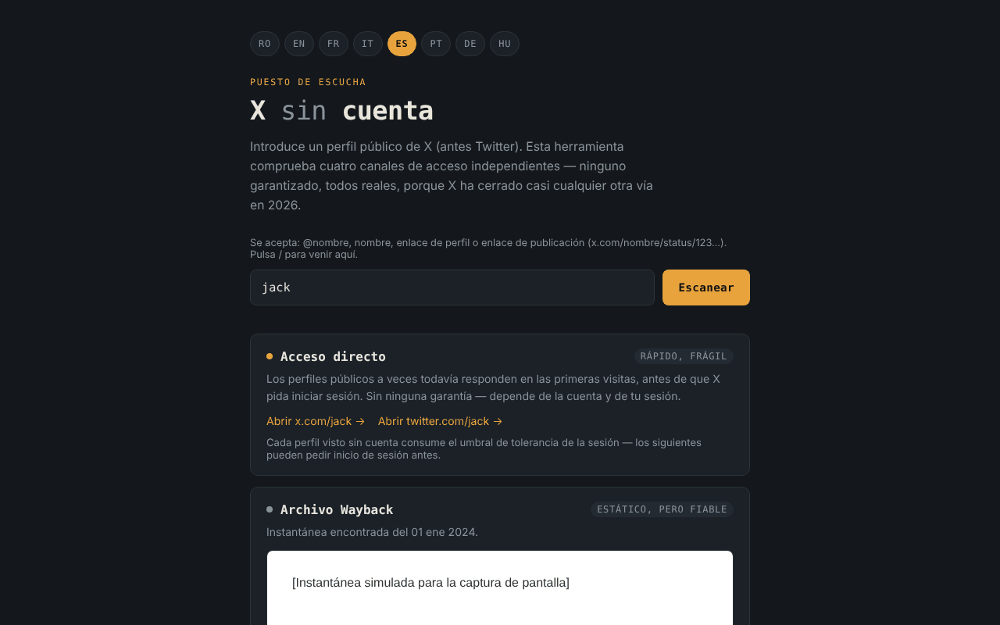

# X fără cont

[English](README.md) · [Română](README.ro.md) · [Français](README.fr.md) · [Italiano](README.it.md) · **Español** · [Português](README.pt.md) · [Deutsch](README.de.md) · [Magyar](README.hu.md)

**Versión:** 2.0.0 · **Última actualización:** 2026-10-26

Idiomas de la interfaz: **Română, English, Français, Italiano, Español, Português (PT), Deutsch, Magyar**

Conjunto de herramientas para ver perfiles públicos de X (antes Twitter) sin cuenta, en 8 idiomas, en un único archivo HTML.

**Aplicación en línea:** https://chiuta.github.io/X-fara-cont/

## Qué es

Introduces un nombre de perfil o un enlace; la aplicación genera cuatro «canales» de acceso, todos sin cuenta y sin garantías: enlace directo, archivo de Wayback Machine, índice de búsqueda (Google/Bing) y remisión a instancias de Nitter. No es un scraper: no lee el contenido de X (el navegador lo bloquea mediante CORS), solo construye enlaces y comprueba la disponibilidad de una instantánea en archive.org.

## Funciones

- Interfaz en 8 idiomas: RO, EN, FR, IT, ES, PT, DE, HU (el idioma del navegador se detecta automáticamente, si no RO; se puede cambiar con los botones).
- Acepta `@nombre`, `nombre`, un enlace de perfil o un enlace de publicación de x.com / twitter.com (`…/nombre/status/123…`); el nombre se valida (1–15 letras, cifras o `_`), y los nombres de secciones del sitio (`home`, `explore`, `i`, `search`, etc.) se rechazan. Para una publicación, los enlaces directos, la consulta a Wayback, la búsqueda en Google/Bing y el enlace «Solicitar una nueva instantánea» apuntan a la dirección exacta de la publicación.
- Para los enlaces de publicación, muestra la fecha de creación de la publicación (UTC), calculada localmente a partir del ID (los ID «snowflake» contienen una marca de tiempo; el cálculo solo se aplica a los ID posteriores a noviembre de 2010). Ayuda a elegir la instantánea de Wayback adecuada; no se realiza ninguna petición de red.
- El enlace «Todas las capturas archivadas» a la lista completa de capturas de Wayback Machine (en todos los estados del canal de archivo).
- Una fila de ayuda sobre el campo con los formatos aceptados; la tecla `/` lleva el foco al campo.
- Canal 1 — enlaces directos a x.com y twitter.com.
- Canal 2 — consulta la API `archive.org/wayback/available` (x.com, luego twitter.com) y, si encuentra una instantánea, la muestra en un marco aislado (sandbox) y ofrece un enlace a Wayback Machine; en caso contrario, ofrece «Solicitar una nueva instantánea». La consulta tiene un tiempo de espera de 8 segundos, y un nuevo análisis cancela el anterior.
- Canal 3 — búsquedas en Google y Bing de `site:x.com OR site:twitter.com "nombre"` (se abren solo al hacer clic).
- Canal 4 — enlace a la lista de instancias de Nitter (GitHub) y patrón de dirección.

## Manual de uso

1. Elige el idioma con los botones superiores (opcional).
2. Escribe el nombre del perfil o pega el enlace y pulsa «Analizar».
3. Usa los enlaces de cada canal; en «Archivo Wayback», espera el resultado de la comprobación.
4. Si no hay archivo, puedes solicitar uno nuevo mediante el enlace ofrecido (se abre en web.archive.org).

## Privacidad y red

- Almacenamiento local: no usa `localStorage`, `sessionStorage`, IndexedDB ni cookies.
- Sin telemetría, sin cuentas, sin scripts ni fuentes externos. La política CSP de la página solo permite conexiones a archive.org.
- Al pulsar «Analizar», **el nombre del perfil se envía a archive.org**: hasta 2 consultas (una para x.com, otra para twitter.com, la segunda solo si la primera no encuentra nada). Si existe una instantánea, el marco carga una página de web.archive.org (un contacto más con archive.org; tu dirección IP es visible para ellos). No se envía referrer.
- Los enlaces a x.com, twitter.com, google.com, bing.com, github.com (Nitter) y web.archive.org (guardado) se abren solo si pulsas sobre ellos.
- No solicita permisos del navegador.

## Límites y advertencias

- Ninguna vía está garantizada: X puede exigir autenticación en cualquier momento, los archivos pueden faltar o ser antiguos, las instancias de Nitter son inestables.
- Las afirmaciones de la interfaz sobre el estado de X/Nitter en 2026 (por ejemplo «X ha cerrado casi cualquier otra vía») son observaciones del autor. El estado de Nitter/XCancel se comprobó el 11.10.2026 (véase Historial); puede cambiar en cualquier momento.
- El archivo puede contener contenido de terceros; el marco está aislado, pero trátalo como cualquier página externa.
- La aplicación no está afiliada a X Corp., Internet Archive, Google, Microsoft ni al proyecto Nitter.

## Ejecución local / sin conexión

Descarga `index.html` y ábrelo en un navegador. La generación de enlaces funciona sin internet; la comprobación del archivo y los enlaces externos necesitan conexión.

## Historial / Registro de cambios

### 1.2.6 — 2026-10-23
- El mensaje «nombre de perfil no válido» se vuelve a traducir al cambiar de idioma; enviar el campo vacío ya no lo marca como no válido sin ningún mensaje.
- Los botones de idioma tienen ahora un área táctil de 44 × 44 px.

### 1.2.4 — 2026-10-22
- fff-kit 1.1.4: objetivos táctiles y texto mínimo

### 1.2.3 — 2026-10-22
- fff-kit 1.1.2: PBKDF2 con 600.000 iteraciones, protección anti-clickjacking.

### 1.2.2 — 2026-10-22
- Móvil: ningún texto por debajo de 12 px y áreas táctiles de al menos 24 px (WCAG 2.5.8).

### 1.2.1 — 2026-10-22
- El título, la meta descripción y la descripción del panel de transparencia fff-kit siguen ahora el idioma de la interfaz.

### 1.1.0 — 2026-10-14
- Copia de seguridad y etiquetado de datos (fff-kit).

### 12 de octubre de 2026 (v1.0.0)
- 1.0.0 — 2026-10-12: la versión y la fecha de la última actualización se muestran en la aplicación

### 11 de octubre de 2026 (tercera entrada)
- Corregido el desbordamiento horizontal a 360 px (reproducido con un enlace de publicación largo: scrollWidth 483 → 360); los enlaces y el patrón de Nitter ahora se parten en varias líneas.
- Fecha de la publicación calculada a partir del ID, en los 7 idiomas.

### 11 de octubre de 2026 (segunda entrada)
- Compatibilidad con enlaces de publicación (`/status/<número>`): instantánea de Wayback, búsqueda y enlaces para la dirección exacta de la publicación.
- Rechazados los nombres reservados del sitio (`home`, `explore`, `i`…) que se aceptaban como nombres de perfil; enlace «Todas las capturas archivadas»; fila de ayuda y atajo `/` (traducidos a 7 idiomas).
- CSP: `script-src` con hash en lugar de `'unsafe-inline'`.
- Captura de pantalla actualizada (la fila de ayuda).

### 11 de octubre de 2026
- La tarjeta «Espejos de Nitter» (en los 7 idiomas) muestra ahora la situación a 11.10.2026: requerimiento de cese de X en agosto de 2026, reanudación anunciada por el proyecto Nitter, XCancel de nuevo en línea, nitter.net oficial todavía sin funcionar.
- Axe: 0 infracciones, sin desbordamiento horizontal a 360 px.

Fuentes comprobadas el 11.10.2026: privacyguides.org (7 sept. 2026, «Alternate X.com frontend Nitter announces it will continue despite the cease and desist»), cybernews.com, alternativeto.net (sept. 2026).

## Licencia

MIT — véase el archivo [LICENSE](LICENSE).

## Autor

Alexio — Alexandru-Ionuț Chiuță, contacto: alexio@trom.tf

## Resumen

X sin cuenta es un conjunto de herramientas en un solo archivo y en 8 idiomas para ver perfiles públicos de X (Twitter) sin iniciar sesión: enlaces directos, una consulta a Wayback Machine, búsquedas en motores de búsqueda y una remisión a espejos de Nitter. También se admiten enlaces de publicaciones (…/status/123). No es un scraper. No usa almacenamiento del navegador ni scripts de terceros. Al pulsar «Analizar», el nombre del perfil se envía a archive.org (hasta dos consultas) y una instantánea encontrada se muestra en un marco aislado desde web.archive.org. Licencia: MIT (véase LICENSE).
