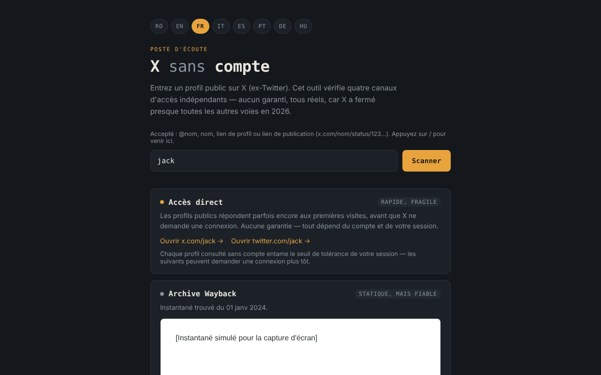

# X fără cont

[English](README.md) · [Română](README.ro.md) · **Français** · [Italiano](README.it.md) · [Español](README.es.md) · [Português](README.pt.md) · [Deutsch](README.de.md) · [Magyar](README.hu.md)

**Version :** 2.1.0 · **Dernière mise à jour :** 2026-10-27

Langues de l'interface : **Română, English, Français, Italiano, Español, Português (PT), Deutsch, Magyar**

Ensemble d'outils pour consulter les profils publics de X (ex-Twitter) sans compte, en 8 langues, dans un seul fichier HTML.

**Application en ligne :** https://chiuta.github.io/X-fara-cont/

## Présentation

Vous saisissez un nom de profil ou un lien ; l'application génère quatre « canaux » d'accès, tous sans compte et sans garantie : lien direct, archive Wayback Machine, index de recherche (Google/Bing) et renvoi vers des instances Nitter. Ce n'est pas un scraper : elle ne lit pas le contenu de X (le navigateur l'empêche via CORS), elle construit seulement des liens et vérifie la disponibilité d'un instantané sur archive.org.

## Fonctionnalités

- Interface en 8 langues : RO, EN, FR, IT, ES, PT, DE, HU (la langue du navigateur est détectée automatiquement, sinon RO ; on peut la changer avec les boutons).
- Accepte `@nom`, `nom`, un lien de profil ou un lien de publication x.com / twitter.com (`…/nom/status/123…`) ; le nom est validé (1 à 15 lettres, chiffres ou `_`), et les noms de sections du site (`home`, `explore`, `i`, `search`, etc.) sont rejetés. Pour une publication, les liens directs, la requête Wayback, la recherche Google/Bing et le lien « Demander un nouvel instantané » visent l'adresse exacte de la publication.
- Pour les liens de publication, affiche la date de création de la publication (UTC), calculée localement à partir de l'ID (les ID « snowflake » contiennent un horodatage ; le calcul ne s'applique qu'aux ID postérieurs à novembre 2010). Cela aide à choisir le bon instantané Wayback ; aucune requête réseau n'est effectuée.
- Le lien « Toutes les captures archivées » vers la liste complète des captures de la Wayback Machine (dans tous les états du canal d'archive).
- Une ligne d'aide au-dessus du champ avec les formats acceptés ; la touche `/` place le focus dans le champ.
- Canal 1 — liens directs vers x.com et twitter.com.
- Canal 2 — interroge l'API `archive.org/wayback/available` (x.com, puis twitter.com) et, s'il trouve un instantané, l'affiche dans un cadre isolé (sandbox) et propose un lien vers la Wayback Machine ; sinon, il propose « Demander un nouvel instantané ». La requête a un délai d'attente de 8 secondes, et une nouvelle analyse annule la précédente.
- Canal 3 — recherches Google et Bing pour `site:x.com OR site:twitter.com "nom"` (ouvertes uniquement au clic).
- Canal 4 — lien vers la liste des instances Nitter (GitHub) et modèle d'adresse.

## Mode d'emploi

1. Choisissez la langue avec les boutons du haut (facultatif).
2. Saisissez le nom du profil ou collez le lien et appuyez sur « Scanner ».
3. Utilisez les liens de chaque canal ; pour « Archive Wayback », attendez le résultat de la vérification.
4. S'il n'existe pas d'archive, vous pouvez en demander une nouvelle via le lien proposé (il s'ouvre sur web.archive.org).

## Confidentialité et réseau

- Stockage local : n'utilise ni `localStorage`, ni `sessionStorage`, ni IndexedDB, ni cookies.
- Pas de télémétrie, pas de comptes, pas de scripts ni de polices externes. La politique CSP de la page n'autorise les connexions que vers archive.org.
- Lors d'un « Scanner », **le nom du profil est envoyé à archive.org** : jusqu'à 2 requêtes (une pour x.com, une pour twitter.com, la seconde uniquement si la première ne trouve rien). S'il existe un instantané, le cadre charge une page de web.archive.org (un contact supplémentaire avec archive.org ; votre adresse IP leur est visible). Aucun référent n'est envoyé.
- Les liens vers x.com, twitter.com, google.com, bing.com, github.com (Nitter) et web.archive.org (enregistrement) ne s'ouvrent que si vous cliquez dessus.
- Ne demande aucune autorisation au navigateur.

## Limites et avertissements

- Aucune voie n'est garantie : X peut exiger une authentification à tout moment, les archives peuvent manquer ou être anciennes, les instances Nitter sont instables.
- Les affirmations de l'interface sur l'état de X/Nitter en 2026 (par exemple « X a fermé presque toutes les autres voies ») sont des observations de l'auteur. L'état de Nitter/XCancel a été vérifié le 11.10.2026 (voir Historique) ; il peut changer à tout moment.
- L'archive peut contenir du contenu de tiers ; le cadre est isolé, mais traitez-le comme n'importe quelle page externe.
- L'application n'est affiliée ni à X Corp., ni à Internet Archive, ni à Google, ni à Microsoft, ni au projet Nitter.

## Exécution locale / hors ligne

Téléchargez `index.html` et ouvrez-le dans un navigateur. La génération des liens fonctionne sans internet ; la vérification de l'archive et les liens externes nécessitent une connexion.

## Historique / Journal des modifications

### 1.2.6 — 2026-10-23
- Le message « nom de profil invalide » est de nouveau traduit lors du changement de langue ; un envoi vide ne marque plus le champ comme invalide sans message.
- Les boutons de langue ont maintenant une cible tactile de 44 × 44 px.

### 1.2.4 — 2026-10-22
- fff-kit 1.1.4 : cibles tactiles et taille de texte minimale

### 1.2.3 — 2026-10-22
- fff-kit 1.1.2 : PBKDF2 à 600 000 itérations, protection anti-clickjacking.

### 1.2.2 — 2026-10-22
- Mobile : aucun texte sous 12 px et cibles tactiles d'au moins 24 px (WCAG 2.5.8).

### 1.2.1 — 2026-10-22
- Le titre, la méta-description et la description du panneau de transparence fff-kit suivent désormais la langue de l'interface.

### 1.1.0 — 2026-10-14
- Sauvegarde et étiquetage des données (fff-kit).

### 12 octobre 2026 (v1.0.0)
- 1.0.0 — 2026-10-12 : la version et la date de dernière mise à jour sont affichées dans l'application

### 11 octobre 2026 (troisième entrée)
- Correction du débordement horizontal à 360 px (reproduit avec un long lien de publication : scrollWidth 483 → 360) ; les liens et le modèle Nitter sont désormais coupés sur plusieurs lignes.
- Date de la publication calculée à partir de l'ID, dans les 7 langues.

### 11 octobre 2026 (deuxième entrée)
- Prise en charge des liens de publication (`/status/<numéro>`) : instantané Wayback, recherche et liens pour l'adresse exacte de la publication.
- Rejet des noms réservés du site (`home`, `explore`, `i`…) qui étaient acceptés comme noms de profil ; lien « Toutes les captures archivées » ; ligne d'aide et raccourci `/` (traduits en 7 langues).
- Politique CSP : `script-src` avec hachage au lieu de `'unsafe-inline'`.
- Capture d'écran mise à jour (la ligne d'aide).

### 11 octobre 2026
- La carte « Miroirs Nitter » (dans les 7 langues) montre désormais la situation au 11.10.2026 : mise en demeure de X en août 2026, reprise annoncée par le projet Nitter, XCancel de nouveau en ligne, nitter.net officiel toujours hors service.
- Axe : 0 violation, pas de débordement horizontal à 360 px.

Sources vérifiées le 11.10.2026 : privacyguides.org (7 sept. 2026, « Alternate X.com frontend Nitter announces it will continue despite the cease and desist »), cybernews.com, alternativeto.net (sept. 2026).

## Licence

MIT — voir le fichier [LICENSE](LICENSE).

## Auteur

Alexio — Alexandru-Ionuț Chiuță, contact : alexio@trom.tf

## Résumé

X sans compte est un ensemble d'outils en un seul fichier et en 8 langues pour consulter les profils publics de X (Twitter) sans se connecter : liens directs, recherche dans la Wayback Machine, requêtes de moteurs de recherche et renvoi vers des miroirs Nitter. Les liens de publication (…/status/123) sont également pris en charge. Ce n'est pas un scraper. Il n'utilise aucun stockage du navigateur ni script tiers. Lors d'un « Scanner », le nom du profil est envoyé à archive.org (jusqu'à deux requêtes) et un instantané trouvé est affiché dans un cadre isolé depuis web.archive.org. Licence : MIT (voir LICENSE).
