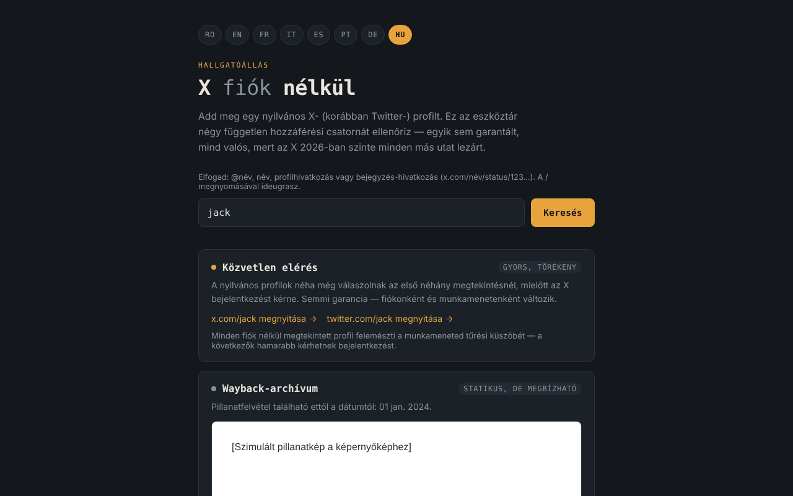

# X fără cont

[English](README.md) · [Română](README.ro.md) · [Français](README.fr.md) · [Italiano](README.it.md) · [Español](README.es.md) · [Português](README.pt.md) · [Deutsch](README.de.md) · **Magyar**

**Verzió:** 2.0.0 · **Utolsó frissítés:** 2026-10-26

A felület nyelvei: **Română, English, Français, Italiano, Español, Português (PT), Deutsch, Magyar**

Eszközkészlet az X (korábban Twitter) nyilvános profiljainak fiók nélküli megtekintéséhez, 8 nyelven, egyetlen HTML-fájlban.

**Online alkalmazás:** https://chiuta.github.io/X-fara-cont/

## Mi ez

Megadsz egy profilnevet vagy egy hivatkozást; az alkalmazás négy hozzáférési „csatornát” állít elő, mindegyik fiók nélkül és garancia nélkül: közvetlen hivatkozás, Wayback Machine-archívum, keresési index (Google/Bing) és átirányítás Nitter-példányokra. Nem scraper: nem olvassa az X tartalmát (a böngésző ezt a CORS-on keresztül megakadályozza), csupán hivatkozásokat épít, és ellenőrzi, hogy elérhető-e pillanatkép az archive.org-on.

## Funkciók

- Felület 8 nyelven: RO, EN, FR, IT, ES, PT, DE, HU (a böngésző nyelvét automatikusan felismeri, egyébként RO; a gombokkal módosítható).
- Elfogadja a `@név`, `név` alakot, egy profilhivatkozást vagy egy x.com / twitter.com bejegyzéshivatkozást (`…/név/status/123…`); a név érvényesítésre kerül (1–15 betű, számjegy vagy `_`), a webhely szekciónevei (`home`, `explore`, `i`, `search` stb.) pedig elutasításra kerülnek. Bejegyzés esetén a közvetlen hivatkozások, a Wayback-lekérdezés, a Google/Bing-keresés és az „Új pillanatkép kérése” hivatkozás a bejegyzés pontos címére mutat.
- Bejegyzéshivatkozásoknál megjeleníti a bejegyzés létrehozásának dátumát (UTC), amelyet helyben, az azonosítóból számol ki (a „snowflake” azonosítók időbélyeget tartalmaznak; a számítás csak a 2010 novembere utáni azonosítókra érvényes). Segít kiválasztani a megfelelő Wayback-pillanatképet; hálózati kérés nem történik.
- A „Minden archivált pillanatkép” hivatkozás a Wayback Machine pillanatképeinek teljes listájára (az archívumcsatorna minden állapotában).
- Súgósor a mező felett az elfogadott formátumokkal; a `/` billentyű a mezőre helyezi a fókuszt.
- 1. csatorna — közvetlen hivatkozások az x.com és a twitter.com oldalra.
- 2. csatorna — lekérdezi az `archive.org/wayback/available` API-t (x.com, majd twitter.com), és ha talál pillanatképet, elkülönített (sandbox) keretben megjeleníti, és hivatkozást ad a Wayback Machine-hez; ellenkező esetben az „Új pillanatkép kérése” lehetőséget kínálja. A lekérdezés időkorlátja 8 másodperc, egy új vizsgálat pedig megszakítja az előzőt.
- 3. csatorna — Google- és Bing-keresések a `site:x.com OR site:twitter.com "név"` kifejezésre (csak kattintásra nyílnak meg).
- 4. csatorna — hivatkozás a Nitter-példányok listájára (GitHub) és a címminta.

## Használati útmutató

1. Válaszd ki a nyelvet a felső gombokkal (nem kötelező).
2. Írd be a profil nevét vagy illeszd be a hivatkozást, és nyomd meg a „Vizsgálat” gombot.
3. Használd az egyes csatornák hivatkozásait; a „Wayback-archívum” esetén várd meg az ellenőrzés eredményét.
4. Ha nincs archívum, újat kérhetsz a felkínált hivatkozáson keresztül (a web.archive.org oldalon nyílik meg).

## Adatvédelem és hálózat

- Helyi tárolás: nem használ `localStorage`-t, `sessionStorage`-t, IndexedDB-t vagy sütiket.
- Nincs telemetria, nincsenek fiókok, nincsenek külső szkriptek vagy betűtípusok. Az oldal CSP-je csak az archive.org felé engedélyez kapcsolatot.
- A „Vizsgálat” során **a profil neve elküldésre kerül az archive.org-nak**: legfeljebb 2 lekérdezés (egy az x.com-ra, egy a twitter.com-ra, a második csak akkor, ha az első nem talál semmit). Ha van pillanatkép, a keret betölt egy oldalt a web.archive.org-ról (még egy kapcsolatfelvétel az archive.org-gal; az IP-címed látható számukra). Hivatkozó (referrer) nem kerül elküldésre.
- Az x.com, twitter.com, google.com, bing.com, github.com (Nitter) és web.archive.org (mentés) felé mutató hivatkozások csak akkor nyílnak meg, ha rájuk kattintasz.
- Nem kér böngészőengedélyeket.

## Korlátok és figyelmeztetések

- Egyetlen út sem garantált: az X bármikor kérhet hitelesítést, az archívumok hiányozhatnak vagy elavultak lehetnek, a Nitter-példányok instabilak.
- A felület állításai az X/Nitter 2026-os állapotáról (például „az X majdnem minden más utat lezárt”) a szerző megfigyelései. A Nitter/XCancel állapotát 2026. 10. 11-én ellenőriztük (lásd Előzmények); bármikor megváltozhat.
- Az archívum harmadik felek tartalmát is tartalmazhatja; a keret elkülönített, de kezeld úgy, mint bármely külső oldalt.
- Az alkalmazás nem áll kapcsolatban az X Corp.-pal, az Internet Archive-val, a Google-lel, a Microsofttal vagy a Nitter projekttel.

## Helyi futtatás / offline

Töltsd le az `index.html` fájlt, és nyisd meg egy böngészőben. A hivatkozások előállítása internet nélkül is működik; az archívum ellenőrzéséhez és a külső hivatkozásokhoz kapcsolat szükséges.

## Előzmények / Változásnapló

### 1.2.6 — 2026-10-23
- Az „érvénytelen profilnév” üzenet nyelvváltáskor újra le van fordítva; üres beküldés már nem jelöli érvénytelennek a mezőt üzenet nélkül.
- A nyelvgombok érintési célpontja most 44 × 44 px.

### 1.2.4 — 2026-10-22
- fff-kit 1.1.4: érintési célpontok és minimális szövegméret

### 1.2.3 — 2026-10-22
- fff-kit 1.1.2: PBKDF2 600 000 iterációval, clickjacking elleni védelem.

### 1.2.2 — 2026-10-22
- Mobil: nincs 12 px alatti szöveg, az érintési célpontok legalább 24 px-esek (WCAG 2.5.8).

### 1.2.1 — 2026-10-22
- A cím, a meta leírás és az fff-kit átláthatósági panel leírása mostantól a felület nyelvét követi.

### 1.1.0 — 2026-10-14
- Biztonsági mentés és adatcímkézés (fff-kit).

### 2026. október 12. (v1.0.0)
- 1.0.0 — 2026-10-12: a verzió és az utolsó frissítés dátuma megjelenik az alkalmazásban

### 2026. október 11. (harmadik bejegyzés)
- Javítva a vízszintes túlcsordulás 360 px-nél (hosszú bejegyzéshivatkozással reprodukálva: scrollWidth 483 → 360); a hivatkozások és a Nitter-minta mostantól több sorba tördelődnek.
- A bejegyzés dátumát az azonosítóból számítja ki, mind a 7 nyelven.

### 2026. október 11. (második bejegyzés)
- Bejegyzéshivatkozások támogatása (`/status/<szám>`): Wayback-pillanatkép, keresés és hivatkozások a bejegyzés pontos címére.
- Elutasítja a webhely fenntartott neveit (`home`, `explore`, `i`…), amelyeket korábban profilnévként elfogadott; „Minden archivált pillanatkép” hivatkozás; súgósor és a `/` billentyűparancs (7 nyelvre lefordítva).
- CSP: `script-src` hash-sel az `'unsafe-inline'` helyett.
- Frissített képernyőkép (a súgósor).

### 2026. október 11.
- A „Nitter-tükrök” kártya (mind a 7 nyelven) mostantól a 2026. 10. 11-i helyzetet mutatja: az X abbahagyásra felszólító értesítése 2026 augusztusában, a Nitter projekt által bejelentett folytatás, az XCancel ismét online, a hivatalos nitter.net továbbra sem működik.
- Axe: 0 szabálysértés, nincs vízszintes túlcsordulás 360 px-nél.

2026. 10. 11-én ellenőrzött források: privacyguides.org (2026. szept. 7., „Alternate X.com frontend Nitter announces it will continue despite the cease and desist”), cybernews.com, alternativeto.net (2026. szept.).

## Licenc

MIT — lásd a [LICENSE](LICENSE) fájlt.

## Szerző

Alexio — Alexandru-Ionuț Chiuță, kapcsolat: alexio@trom.tf

## Összefoglaló

Az X fiók nélkül egy egyfájlos, 8 nyelvű eszközkészlet az X (Twitter) nyilvános profiljainak bejelentkezés nélküli megtekintéséhez: közvetlen hivatkozások, Wayback Machine-keresés, keresőmotoros lekérdezések és átirányítás Nitter-tükrökre. A bejegyzéshivatkozások (…/status/123) is támogatottak. Nem scraper. Nem használ böngészőtárolást és harmadik féltől származó szkripteket. A „Vizsgálat” során a profil neve elküldésre kerül az archive.org-nak (legfeljebb két lekérdezés), a talált pillanatkép pedig elkülönített keretben jelenik meg a web.archive.org-ról. Licenc: MIT (lásd LICENSE).
