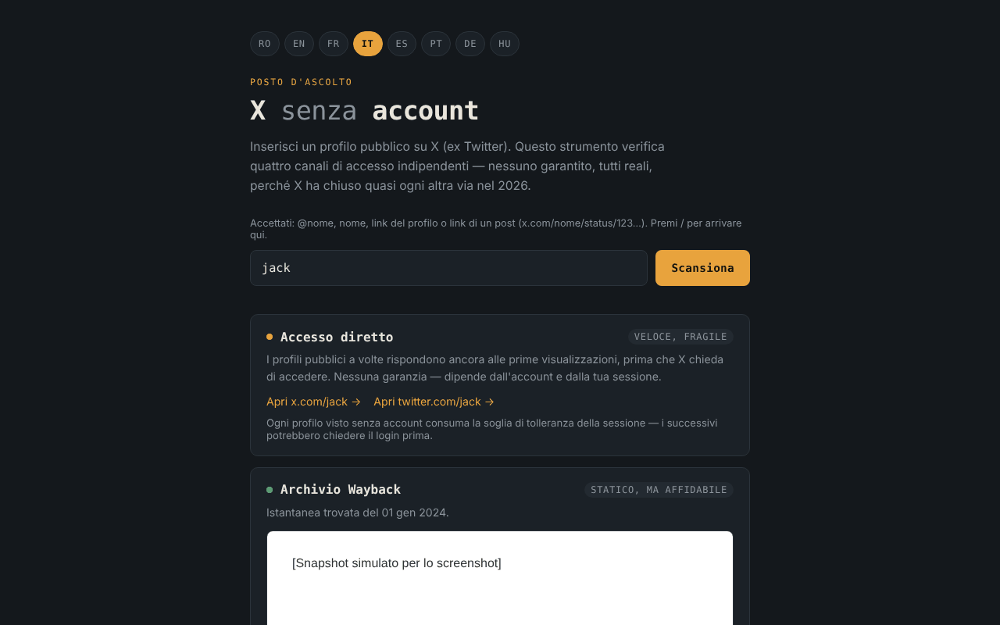

# X fără cont

[English](README.md) · [Română](README.ro.md) · [Français](README.fr.md) · **Italiano** · [Español](README.es.md) · [Português](README.pt.md) · [Deutsch](README.de.md) · [Magyar](README.hu.md)

**Versione:** 1.2.3 · **Ultimo aggiornamento:** 2026-10-22

Lingue dell'interfaccia: **Română, English, Français, Italiano, Español, Português (PT), Deutsch, Magyar**

Set di strumenti per visualizzare i profili pubblici di X (ex Twitter) senza account, in 8 lingue, in un unico file HTML.

**App online:** https://chiuta.github.io/X-fara-cont/

## Che cos'è

Inserisci il nome di un profilo o un link; l'applicazione genera quattro «canali» di accesso, tutti senza account e senza garanzie: link diretto, archivio Wayback Machine, indice di ricerca (Google/Bing) e rimando a istanze Nitter. Non è uno scraper: non legge i contenuti di X (il browser lo impedisce tramite CORS), ma si limita a costruire link e a verificare la disponibilità di uno snapshot su archive.org.

## Funzioni

- Interfaccia in 8 lingue: RO, EN, FR, IT, ES, PT, DE, HU (la lingua del browser viene rilevata automaticamente, altrimenti RO; si può cambiare con i pulsanti).
- Accetta `@nome`, `nome`, un link di profilo o un link a un post di x.com / twitter.com (`…/nome/status/123…`); il nome viene validato (1–15 lettere, cifre o `_`), e i nomi delle sezioni del sito (`home`, `explore`, `i`, `search` ecc.) vengono rifiutati. Per un post, i link diretti, la query Wayback, la ricerca Google/Bing e il link «Richiedi un nuovo snapshot» puntano all'indirizzo esatto del post.
- Per i link a un post, mostra la data di creazione del post (UTC), calcolata localmente dall'ID (gli ID «snowflake» contengono un timestamp; il calcolo si applica solo agli ID successivi a novembre 2010). Aiuta a scegliere lo snapshot Wayback giusto; non viene effettuata alcuna richiesta di rete.
- Il link «Tutte le acquisizioni archiviate» alla lista completa delle acquisizioni della Wayback Machine (in tutti gli stati del canale di archivio).
- Una riga di aiuto sopra il campo con i formati accettati; il tasto `/` sposta il focus nel campo.
- Canale 1 — link diretti a x.com e twitter.com.
- Canale 2 — interroga l'API `archive.org/wayback/available` (x.com, poi twitter.com) e, se trova uno snapshot, lo mostra in un frame isolato (sandbox) e offre un link alla Wayback Machine; altrimenti offre «Richiedi un nuovo snapshot». La richiesta ha un timeout di 8 secondi e una nuova scansione annulla la precedente.
- Canale 3 — ricerche Google e Bing per `site:x.com OR site:twitter.com "nome"` (si aprono solo al clic).
- Canale 4 — link all'elenco delle istanze Nitter (GitHub) e modello di indirizzo.

## Guida all'uso

1. Scegli la lingua con i pulsanti in alto (facoltativo).
2. Scrivi il nome del profilo o incolla il link e premi «Scansiona».
3. Usa i link di ciascun canale; per «Archivio Wayback» attendi il risultato della verifica.
4. Se non esiste un archivio, puoi richiederne uno nuovo tramite il link offerto (si apre su web.archive.org).

## Riservatezza e rete

- Archiviazione locale: non usa `localStorage`, `sessionStorage`, IndexedDB né cookie.
- Nessuna telemetria, nessun account, nessuno script o font esterno. La CSP della pagina consente connessioni solo verso archive.org.
- Con «Scansiona», **il nome del profilo viene inviato ad archive.org**: fino a 2 richieste (una per x.com, una per twitter.com, la seconda solo se la prima non trova nulla). Se esiste uno snapshot, il frame carica una pagina da web.archive.org (un ulteriore contatto con archive.org; il tuo indirizzo IP è visibile per loro). Non viene inviato alcun referrer.
- I link a x.com, twitter.com, google.com, bing.com, github.com (Nitter) e web.archive.org (salvataggio) si aprono solo se li premi.
- Non richiede permessi al browser.

## Limiti e avvertenze

- Nessun percorso è garantito: X può richiedere l'autenticazione in qualsiasi momento, gli archivi possono mancare o essere vecchi, le istanze Nitter sono instabili.
- Le affermazioni dell'interfaccia sullo stato di X/Nitter nel 2026 (per esempio «X ha chiuso quasi ogni altra via») sono osservazioni dell'autore. Lo stato di Nitter/XCancel è stato verificato l'11.10.2026 (vedi Cronologia); può cambiare in qualsiasi momento.
- L'archivio può contenere contenuti di terzi; il frame è isolato, ma trattalo come qualsiasi pagina esterna.
- L'applicazione non è affiliata a X Corp., Internet Archive, Google, Microsoft o al progetto Nitter.

## Esecuzione locale / offline

Scarica `index.html` e aprilo in un browser. La generazione dei link funziona senza internet; la verifica dell'archivio e i link esterni richiedono una connessione.

## Cronologia / Changelog

### 1.2.3 — 2026-10-22
- fff-kit 1.1.2: PBKDF2 a 600.000 iterazioni, protezione anti-clickjacking.

### 1.2.2 — 2026-10-22
- Mobile: nessun testo sotto i 12 px e aree tattili di almeno 24 px (WCAG 2.5.8).

### 1.2.1 — 2026-10-22
- Il titolo, la meta descrizione e la descrizione del pannello di trasparenza fff-kit seguono ora la lingua dell'interfaccia.

### 1.1.0 — 2026-10-14
- Copia di riserva ed etichettatura dei dati (fff-kit).

### 12 ottobre 2026 (v1.0.0)
- 1.0.0 — 2026-10-12: la versione e la data dell'ultimo aggiornamento sono mostrate nell'applicazione

### 11 ottobre 2026 (terza voce)
- Corretto l'overflow orizzontale a 360 px (riprodotto con un lungo link a un post: scrollWidth 483 → 360); i link e il modello Nitter ora vanno a capo su più righe.
- Data del post calcolata dall'ID, nelle 7 lingue.

### 11 ottobre 2026 (seconda voce)
- Supporto per i link ai post (`/status/<numero>`): snapshot Wayback, ricerca e link per l'indirizzo esatto del post.
- Rifiutati i nomi riservati del sito (`home`, `explore`, `i`…) che venivano accettati come nomi di profilo; link «Tutte le acquisizioni archiviate»; riga di aiuto e scorciatoia `/` (tradotte in 7 lingue).
- CSP: `script-src` con hash invece di `'unsafe-inline'`.
- Schermata aggiornata (la riga di aiuto).

### 11 ottobre 2026
- La scheda «Mirror Nitter» (in tutte le 7 lingue) mostra ora la situazione all'11.10.2026: diffida da parte di X nell'agosto 2026, ripresa annunciata dal progetto Nitter, XCancel di nuovo online, nitter.net ufficiale ancora non funzionante.
- Axe: 0 violazioni, nessun overflow orizzontale a 360 px.

Fonti verificate l'11.10.2026: privacyguides.org (7 sett. 2026, «Alternate X.com frontend Nitter announces it will continue despite the cease and desist»), cybernews.com, alternativeto.net (sett. 2026).

## Licenza

MIT — vedi il file [LICENSE](LICENSE).

## Autore

Alexio — Alexandru-Ionuț Chiuță, contatto: alexio@trom.tf

## Riepilogo

X senza account è un set di strumenti in un unico file e in 8 lingue per guardare i profili pubblici di X (Twitter) senza accedere: link diretti, una ricerca nella Wayback Machine, query sui motori di ricerca e un rimando ai mirror Nitter. Sono supportati anche i link ai post (…/status/123). Non è uno scraper. Non usa archiviazione del browser né script di terze parti. Con «Scansiona», il nome del profilo viene inviato ad archive.org (fino a due ricerche) e uno snapshot trovato viene mostrato in un frame isolato da web.archive.org. Licenza: MIT (vedi LICENSE).
