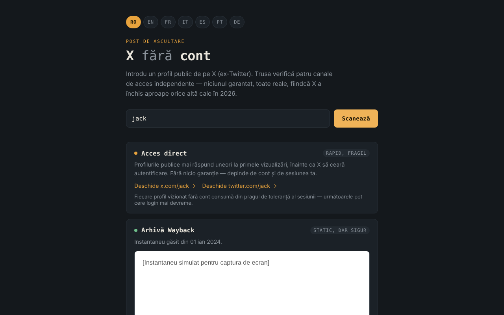

# X fără cont

**English** · [Română](README.ro.md) · [Français](README.fr.md) · [Italiano](README.it.md) · [Español](README.es.md) · [Português](README.pt.md) · [Deutsch](README.de.md) · [Magyar](README.hu.md)

**Version:** 1.1.0 · **Last updated:** 2026-10-14

A toolkit for viewing public profiles on X (formerly Twitter) without an account, in 7 languages, in a single HTML file.

**Live app:** https://chiuta.github.io/X-fara-cont/

## What it is

You enter a profile name or a link; the application generates four access "channels", all without an account and without guarantees: a direct link, a Wayback Machine archive, a search index (Google/Bing) and a pointer to Nitter instances. It is not a scraper: it does not read X content (the browser blocks that through CORS), it only builds links and checks whether a snapshot is available at archive.org.

## Features

- Interface in 7 languages: RO, EN, FR, IT, ES, PT, DE (the browser language is detected automatically, otherwise RO; it can be changed with the buttons).
- Accepts `@name`, `name`, a profile link or an x.com / twitter.com post link (`…/name/status/123…`); the name is validated (1–15 letters, digits or `_`), and the site's section names (`home`, `explore`, `i`, `search`, etc.) are rejected. For a post, the direct links, the Wayback query, the Google/Bing search and the "Request a new snapshot" link all target the exact address of the post.
- For post links, it shows the creation date of the post (UTC), computed locally from the ID (snowflake IDs contain a timestamp; the calculation only applies to IDs from after November 2010). This helps in choosing the right Wayback snapshot; no network request is made.
- The "All archived captures" link to the full list of captures in the Wayback Machine (in all states of the archive channel).
- A help row above the field with the accepted formats; the `/` key moves focus to the field.
- Channel 1 — direct links to x.com and twitter.com.
- Channel 2 — queries the `archive.org/wayback/available` API (x.com, then twitter.com) and, if it finds a snapshot, displays it in an isolated (sandboxed) frame and offers a link to the Wayback Machine; otherwise it offers "Request a new snapshot". The query has an 8-second timeout, and a new scan cancels the previous one.
- Channel 3 — Google and Bing searches for `site:x.com OR site:twitter.com "name"` (opened only on click).
- Channel 4 — link to the list of Nitter instances (GitHub) and the address pattern.

## User guide

1. Choose the language with the buttons at the top (optional).
2. Type the profile name or paste the link and press "Scan".
3. Use the links in each channel; for "Wayback archive", wait for the result of the check.
4. If there is no archive, you can request a new one through the link provided (it opens on web.archive.org).

## Privacy and network

- Local storage: it does not use `localStorage`, `sessionStorage`, IndexedDB or cookies.
- No telemetry, no accounts, no external scripts or fonts. The CSP in the page only allows connections to archive.org.
- On "Scan", **the profile name is sent to archive.org**: up to 2 queries (one for x.com, one for twitter.com, the second only if the first finds nothing). If a snapshot exists, the frame loads a page from web.archive.org (one more contact with archive.org; your IP address is visible to them). No referrer is sent.
- Links to x.com, twitter.com, google.com, bing.com, github.com (Nitter) and web.archive.org (saving) open only if you click them.
- It requests no browser permissions.

## Limits and warnings

- No path is guaranteed: X can require authentication at any time, archives may be missing or outdated, Nitter instances are unstable.
- The statements in the interface about the state of X/Nitter in 2026 (for example "X has closed almost every other path") are the author's observations. The state of Nitter/XCancel was checked on 11.10.2026 (see History); it can change at any time.
- The archive may contain third-party content; the frame is isolated, but treat it like any external page.
- The application is not affiliated with X Corp., Internet Archive, Google, Microsoft or the Nitter project.

## Running locally / offline

Download `index.html` and open it in a browser. Link generation works without internet; the archive check and external links need a connection.

## History / Changelog

### 1.1.0 — 2026-10-14
- Backup and data labelling (fff-kit).

### 12 October 2026 (v1.0.0)
- 1.0.0 — 2026-10-12: the version and the date of the last update are shown in the application

### 11 October 2026 (third entry)
- Fixed horizontal overflow at 360 px (reproduced with a long post link: scrollWidth 483 → 360); links and the Nitter pattern now wrap onto several lines.
- Post date computed from the ID, in all 7 languages.

### 11 October 2026 (second entry)
- Support for post links (`/status/<number>`): Wayback snapshot, search and links for the exact address of the post.
- Rejected the site's reserved names (`home`, `explore`, `i`…) that were being accepted as profile names; "All archived captures" link; help row and the `/` shortcut (translated into 7 languages).
- CSP: `script-src` with a hash instead of `'unsafe-inline'`.
- Screenshot updated (the help row).

### 11 October 2026
- The "Nitter mirrors" card (in all 7 languages) now shows the situation as of 11.10.2026: cease-and-desist notice from X in August 2026, resumption announced by the Nitter project, XCancel back online, the official nitter.net still not working.
- Axe: 0 violations, no horizontal overflow at 360 px.

Sources checked on 11.10.2026: privacyguides.org (7 Sept. 2026, "Alternate X.com frontend Nitter announces it will continue despite the cease and desist"), cybernews.com, alternativeto.net (Sept. 2026).

## License

MIT — see the [LICENSE](LICENSE) file.

## Author

Alexio — Alexandru-Ionuț Chiuță, contact: alexio@trom.tf

## Summary

X without an account is a single-file, 7-language toolkit for looking at public X (Twitter) profiles without logging in: direct links, a Wayback Machine lookup, search-engine queries and a pointer to Nitter mirrors. Post links (…/status/123) are supported too. It is not a scraper. It uses no browser storage and no third-party scripts. On “Scan”, the profile name is sent to archive.org (up to two lookups) and a found snapshot is shown in a sandboxed frame from web.archive.org. License: MIT (see LICENSE).
