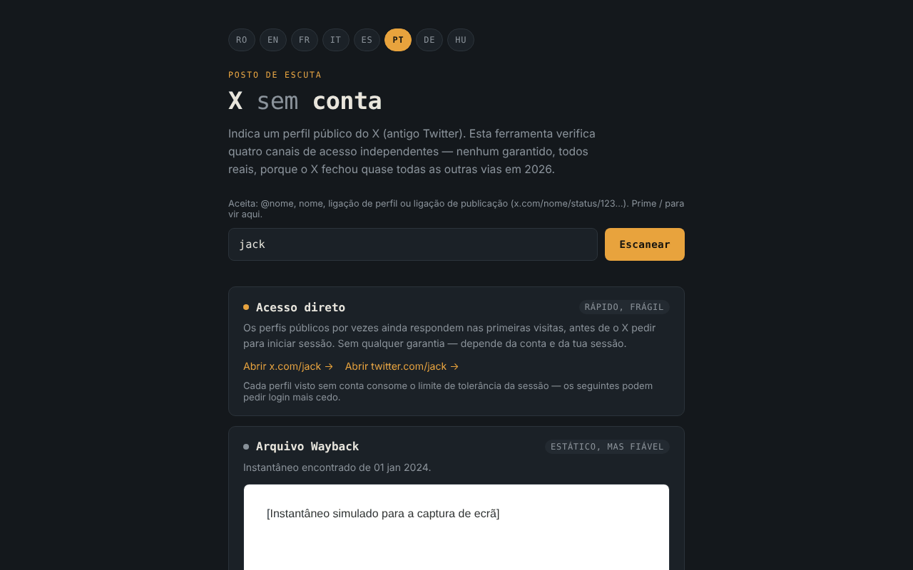

# X fără cont

[English](README.md) · [Română](README.ro.md) · [Français](README.fr.md) · [Italiano](README.it.md) · [Español](README.es.md) · **Português** · [Deutsch](README.de.md) · [Magyar](README.hu.md)

**Versão:** 2.1.0 · **Última atualização:** 2026-10-27

Idiomas da interface: **Română, English, Français, Italiano, Español, Português (PT), Deutsch, Magyar**

Conjunto de ferramentas para ver perfis públicos do X (antigo Twitter) sem conta, em 8 idiomas, num único ficheiro HTML.

**Aplicação online:** https://chiuta.github.io/X-fara-cont/

## O que é

Introduz um nome de perfil ou uma ligação; a aplicação gera quatro «canais» de acesso, todos sem conta e sem garantias: ligação direta, arquivo da Wayback Machine, índice de pesquisa (Google/Bing) e remissão para instâncias Nitter. Não é um scraper: não lê o conteúdo do X (o navegador bloqueia-o através de CORS), apenas constrói ligações e verifica a disponibilidade de um instantâneo em archive.org.

## Funcionalidades

- Interface em 8 idiomas: RO, EN, FR, IT, ES, PT, DE, HU (o idioma do navegador é detetado automaticamente, caso contrário RO; pode ser alterado com os botões).
- Aceita `@nome`, `nome`, uma ligação de perfil ou uma ligação de publicação de x.com / twitter.com (`…/nome/status/123…`); o nome é validado (1–15 letras, algarismos ou `_`), e os nomes de secções do site (`home`, `explore`, `i`, `search`, etc.) são rejeitados. Para uma publicação, as ligações diretas, a consulta Wayback, a pesquisa Google/Bing e a ligação «Pedir um novo instantâneo» visam o endereço exato da publicação.
- Para ligações de publicações, mostra a data de criação da publicação (UTC), calculada localmente a partir do ID (os ID «snowflake» contêm um carimbo de data/hora; o cálculo aplica-se apenas a ID posteriores a novembro de 2010). Ajuda a escolher o instantâneo Wayback adequado; não é feito nenhum pedido de rede.
- A ligação «Todas as capturas arquivadas» para a lista completa de capturas da Wayback Machine (em todos os estados do canal de arquivo).
- Uma linha de ajuda por cima do campo com os formatos aceites; a tecla `/` move o foco para o campo.
- Canal 1 — ligações diretas para x.com e twitter.com.
- Canal 2 — consulta a API `archive.org/wayback/available` (x.com, depois twitter.com) e, se encontrar um instantâneo, mostra-o numa moldura isolada (sandbox) e oferece uma ligação para a Wayback Machine; caso contrário, oferece «Pedir um novo instantâneo». A consulta tem um limite de tempo de 8 segundos, e uma nova análise cancela a anterior.
- Canal 3 — pesquisas Google e Bing por `site:x.com OR site:twitter.com "nome"` (abrem-se apenas ao clicar).
- Canal 4 — ligação para a lista de instâncias Nitter (GitHub) e o padrão de endereço.

## Manual de utilização

1. Escolha o idioma com os botões do topo (opcional).
2. Escreva o nome do perfil ou cole a ligação e prima «Analisar».
3. Utilize as ligações de cada canal; em «Arquivo Wayback», aguarde o resultado da verificação.
4. Se não existir arquivo, pode pedir um novo através da ligação oferecida (abre-se em web.archive.org).

## Privacidade e rede

- Armazenamento local: não utiliza `localStorage`, `sessionStorage`, IndexedDB nem cookies.
- Sem telemetria, sem contas, sem scripts nem tipos de letra externos. A política CSP da página só permite ligações a archive.org.
- Ao «Analisar», **o nome do perfil é enviado para archive.org**: até 2 consultas (uma para x.com, outra para twitter.com, a segunda apenas se a primeira não encontrar nada). Se existir um instantâneo, a moldura carrega uma página de web.archive.org (mais um contacto com archive.org; o seu endereço IP fica visível para eles). Não é enviado referrer.
- As ligações para x.com, twitter.com, google.com, bing.com, github.com (Nitter) e web.archive.org (gravação) só se abrem se clicar nelas.
- Não pede permissões ao navegador.

## Limites e avisos

- Nenhum caminho é garantido: o X pode exigir autenticação a qualquer momento, os arquivos podem faltar ou estar desatualizados, as instâncias Nitter são instáveis.
- As afirmações da interface sobre o estado do X/Nitter em 2026 (por exemplo «o X fechou quase todos os outros caminhos») são observações do autor. O estado do Nitter/XCancel foi verificado em 11.10.2026 (ver Histórico); pode mudar a qualquer momento.
- O arquivo pode conter conteúdo de terceiros; a moldura é isolada, mas trate-a como qualquer página externa.
- A aplicação não está afiliada à X Corp., ao Internet Archive, à Google, à Microsoft nem ao projeto Nitter.

## Execução local / offline

Descarregue `index.html` e abra-o num navegador. A geração de ligações funciona sem internet; a verificação do arquivo e as ligações externas precisam de ligação.

## Histórico / Registo de alterações

### 1.2.6 — 2026-10-23
- A mensagem «nome de perfil inválido» volta a ser traduzida ao mudar de idioma; enviar o campo vazio já não o marca como inválido sem qualquer mensagem.
- Os botões de idioma têm agora uma área tátil de 44 × 44 px.

### 1.2.4 — 2026-10-22
- fff-kit 1.1.4: alvos táteis e texto mínimo

### 1.2.3 — 2026-10-22
- fff-kit 1.1.2: PBKDF2 com 600.000 iterações, proteção anti-clickjacking.

### 1.2.2 — 2026-10-22
- Telemóvel: nenhum texto abaixo de 12 px e áreas táteis de pelo menos 24 px (WCAG 2.5.8).

### 1.2.1 — 2026-10-22
- O título, a meta descrição e a descrição do painel de transparência fff-kit seguem agora o idioma da interface.

### 1.1.0 — 2026-10-14
- Cópia de segurança e etiquetagem de dados (fff-kit).

### 12 de outubro de 2026 (v1.0.0)
- 1.0.0 — 2026-10-12: a versão e a data da última atualização são mostradas na aplicação

### 11 de outubro de 2026 (terceira entrada)
- Corrigido o excesso horizontal a 360 px (reproduzido com uma ligação de publicação longa: scrollWidth 483 → 360); as ligações e o padrão Nitter quebram agora em várias linhas.
- Data da publicação calculada a partir do ID, nos 7 idiomas.

### 11 de outubro de 2026 (segunda entrada)
- Suporte para ligações de publicações (`/status/<número>`): instantâneo Wayback, pesquisa e ligações para o endereço exato da publicação.
- Rejeitados os nomes reservados do site (`home`, `explore`, `i`…) que eram aceites como nomes de perfil; ligação «Todas as capturas arquivadas»; linha de ajuda e atalho `/` (traduzidos em 7 idiomas).
- CSP: `script-src` com hash em vez de `'unsafe-inline'`.
- Captura de ecrã atualizada (a linha de ajuda).

### 11 de outubro de 2026
- O cartão «Espelhos Nitter» (nos 7 idiomas) mostra agora a situação a 11.10.2026: notificação de cessação do X em agosto de 2026, retoma anunciada pelo projeto Nitter, XCancel novamente online, nitter.net oficial ainda sem funcionar.
- Axe: 0 violações, sem excesso horizontal a 360 px.

Fontes verificadas em 11.10.2026: privacyguides.org (7 set. 2026, «Alternate X.com frontend Nitter announces it will continue despite the cease and desist»), cybernews.com, alternativeto.net (set. 2026).

## Licença

MIT — veja o ficheiro [LICENSE](LICENSE).

## Autor

Alexio — Alexandru-Ionuț Chiuță, contacto: alexio@trom.tf

## Resumo

X sem conta é um conjunto de ferramentas num único ficheiro e em 8 idiomas para ver perfis públicos do X (Twitter) sem iniciar sessão: ligações diretas, uma consulta à Wayback Machine, pesquisas em motores de busca e uma remissão para espelhos Nitter. As ligações de publicações (…/status/123) também são suportadas. Não é um scraper. Não utiliza armazenamento do navegador nem scripts de terceiros. Ao «Analisar», o nome do perfil é enviado para archive.org (até duas consultas) e um instantâneo encontrado é mostrado numa moldura isolada a partir de web.archive.org. Licença: MIT (veja LICENSE).
