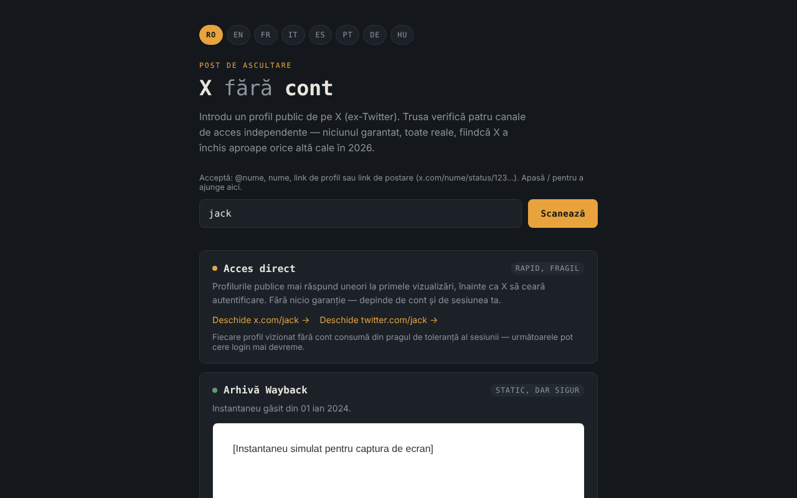

# X fără cont

[English](README.md) · **Română** · [Français](README.fr.md) · [Italiano](README.it.md) · [Español](README.es.md) · [Português](README.pt.md) · [Deutsch](README.de.md) · [Magyar](README.hu.md)

**Versiune:** 1.2.0 · **Ultima actualizare:** 2026-10-19

Limbile interfeței: **Română, English, Français, Italiano, Español, Português (PT), Deutsch, Magyar**

Set de unelte pentru vizualizarea profilurilor publice de pe X (ex-Twitter) fără cont, în 8 limbi, într-un singur fișier HTML.

**Live:** https://chiuta.github.io/X-fara-cont/

## Ce este

Introduci un nume de profil sau un link; aplicația generează patru „canale” de acces, toate fără cont și fără garanții: link direct, arhivă Wayback Machine, index de căutare (Google/Bing) și trimitere către instanțe Nitter. Nu este un scraper: nu citește conținutul X (browserul blochează asta prin CORS), ci doar construiește linkuri și verifică disponibilitatea unui instantaneu la archive.org.

## Funcții

- Interfață în 8 limbi: RO, EN, FR, IT, ES, PT, DE, HU (limba browserului este detectată automat, altfel RO; se poate schimba din butoane).
- Acceptă `@nume`, `nume`, un link de profil sau un link de postare x.com / twitter.com (`…/nume/status/123…`); numele este validat (1–15 litere, cifre sau `_`), iar numele de secțiuni ale site-ului (`home`, `explore`, `i`, `search` etc.) sunt respinse. Pentru o postare, linkurile directe, interogarea Wayback, căutarea Google/Bing și linkul „Cere un instantaneu nou” vizează adresa exactă a postării.
- Pentru linkuri de postare, afișează data creării postării (UTC), calculată local din ID (ID-urile „snowflake” conțin marca de timp; calculul se aplică doar ID-urilor de după noiembrie 2010). Ajută la alegerea instantaneului Wayback potrivit; nu se face nicio cerere de rețea.
- Linkul „Toate capturile arhivate” către lista completă de capturi din Wayback Machine (în toate stările canalului de arhivă).
- Rând de ajutor deasupra câmpului cu formatele acceptate; tasta `/` mută focusul în câmp.
- Canal 1 — linkuri directe către x.com și twitter.com.
- Canal 2 — interoghează API-ul `archive.org/wayback/available` (x.com, apoi twitter.com) și, dacă găsește un instantaneu, îl afișează într-un cadru izolat (sandbox) și oferă link către Wayback Machine; altfel oferă „Cere un instantaneu nou”. Interogarea are timeout de 8 secunde, iar o nouă scanare o anulează pe cea anterioară.
- Canal 3 — căutări Google și Bing pentru `site:x.com OR site:twitter.com "nume"` (se deschid doar la click).
- Canal 4 — link către lista de instanțe Nitter (GitHub) și tiparul de adresă.

## Manual de utilizare

1. Alege limba din butoanele de sus (opțional).
2. Scrie numele profilului sau lipește linkul și apasă „Scanează”.
3. Folosește linkurile din fiecare canal; la „Arhivă Wayback” așteaptă rezultatul verificării.
4. Dacă nu există arhivă, poți cere una nouă prin linkul oferit (se deschide pe web.archive.org).

## Confidențialitate și rețea

- Stocare locală: nu folosește `localStorage`, `sessionStorage`, IndexedDB sau cookie-uri.
- Fără telemetrie, fără conturi, fără scripturi sau fonturi externe. Politica CSP din pagină permite conexiuni doar către archive.org.
- La „Scanează”, **numele profilului este trimis către archive.org**: până la 2 interogări (una pentru x.com, una pentru twitter.com, a doua doar dacă prima nu găsește nimic). Dacă există instantaneu, cadrul încarcă o pagină de pe web.archive.org (încă un contact cu archive.org; adresa ta IP este vizibilă pentru ei). Nu se trimite referrer.
- Linkurile către x.com, twitter.com, google.com, bing.com, github.com (Nitter) și web.archive.org (salvare) se deschid doar dacă le apeși.
- Nu cere permisiuni de browser.

## Limite și avertismente

- Nicio cale nu e garantată: X poate cere autentificare oricând, arhivele pot lipsi sau pot fi vechi, instanțele Nitter sunt instabile.
- Afirmațiile din interfață despre starea X/Nitter în 2026 (de exemplu „X a închis aproape orice altă cale”) sunt observații ale autorului. Starea Nitter/XCancel a fost verificată la 11.10.2026 (vezi Istoric); ea se poate schimba oricând.
- Arhiva poate conține conținut al unor terți; cadrul este izolat, dar tratează-l ca pe orice pagină externă.
- Aplicația nu este afiliată cu X Corp., Internet Archive, Google, Microsoft sau proiectul Nitter.

## Rulare locală / offline

Descarcă `index.html` și deschide-l în browser. Generarea linkurilor funcționează fără internet; verificarea arhivei și linkurile externe au nevoie de conexiune.

## Istoric / Changelog

### 1.1.0 — 2026-10-14
- Copie de rezervă și etichetare date (fff-kit).

### 12 octombrie 2026 (v1.0.0)
- 1.0.0 — 2026-10-12: versiunea și data ultimei actualizări sunt afișate în aplicație

### 11 octombrie 2026 (a treia intrare)
- Corectată depășirea orizontală la 360 px (reprodusă cu un link de postare lung: scrollWidth 483 → 360); linkurile și tiparul Nitter se rup acum pe mai multe rânduri.
- Data postării calculată din ID, în cele 7 limbi.

### 11 octombrie 2026 (a doua intrare)
- Suport pentru linkuri de postare (`/status/<număr>`): instantaneu Wayback, căutare și linkuri pentru adresa exactă a postării.
- Respinse numele rezervate de site (`home`, `explore`, `i`…) care erau acceptate ca nume de profil; link „Toate capturile arhivate”; rând de ajutor și scurtătura `/` (traduse în 7 limbi).
- Politica CSP: `script-src` cu hash în loc de `'unsafe-inline'`.
- Captura de ecran actualizată (rândul de ajutor).

### 11 octombrie 2026
- Cardul „Oglinzi Nitter” (în toate cele 7 limbi) arată acum situația la 11.10.2026: notificare de încetare de la X în august 2026, reluarea anunțată de proiectul Nitter, XCancel revenit online, nitter.net oficial încă nefuncțional.
- Axe: 0 violări, fără depășire orizontală la 360 px.

Surse verificate la 11.10.2026: privacyguides.org (7 sept. 2026, „Alternate X.com frontend Nitter announces it will continue despite the cease and desist”), cybernews.com, alternativeto.net (sept. 2026).

## Licență

MIT — vezi fișierul [LICENSE](LICENSE).

## Autor

Alexio — Alexandru-Ionuț Chiuță, contact: alexio@trom.tf

## English summary

X without an account is a single-file, 8-language toolkit for looking at public X (Twitter) profiles without logging in: direct links, a Wayback Machine lookup, search-engine queries and a pointer to Nitter mirrors. Post links (…/status/123) are supported too. It is not a scraper. It uses no browser storage and no third-party scripts. On “Scan”, the profile name is sent to archive.org (up to two lookups) and a found snapshot is shown in a sandboxed frame from web.archive.org. License: MIT (see LICENSE).
